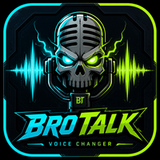

# BroTalk ⚡
> **Low-Latency (<15ms) System-Wide Windows Voice Changer, Soundboard & EchoPrank Sampler**


<p align="center">
  
</p>

---

## 🚀 Key Features

### 1. 🎙️ Real-Time Voice Modulation Engine (<15ms Latency)
- **High-Performance Audio I/O:** Powered by native Windows WASAPI and decoupled lock-free ring buffers (`ringbuf`).
- **Windows MMCSS Integration:** Automatically elevates audio threads to Windows Multimedia Class Scheduler Service (**Pro Audio** priority) to prevent stutter during heavy gaming.
- **7 Esports Presets:**
  - 🗿 **Titan / Deep Voice:** -7.0 semitone pitch shift with chest formant resonance and sub-bass saturation.
  - 🐿️ **Helium / Chipmunk:** +9.0 semitone high squeak cartoon vocal shift.
  - 🤖 **Cyber Robot:** 120 Hz ring-modulated mechanical cyborg tone.
  - 📻 **Tactical Radio:** Military walkie-talkie bandpass filtering (300Hz-3000Hz) with asymmetric overdrive.
  - 👽 **Extraterrestrial Alien:** 8 Hz LFO pitch vibrato warping with diode wave shaping.
  - ⛪ **Cathedral Reverb:** Schroeder Feedback Delay Network (FDN) reverb with lush acoustic decay.
  - 🎛️ **Custom DSP:** Fine-tuning parametric pitch, formant factor, and carrier frequency sliders.
- **Hear Myself Monitor:** Low-latency sidetone output to your headphones with zero ambient floor hiss (`NOISE_GATE_THRESHOLD = 0.015`).

### 2. 🔄 "EchoPrank" Friend Voice Sampler & Instant Replay
- **WASAPI Loopback Capture:** Continuously records incoming Discord, TeamSpeak, or in-game voice chat.
- **30-Second Rolling Circular Buffer:** Always keeps the last 30 seconds of your friend's voice in RAM.
- **Instant Hotkey Clipping (`Ctrl + Shift + R`):** Slices the last 5 to 15 seconds into an armed prank pad.
- **Instant Mic Stream Injection (`Ctrl + Shift + P`):** Broadcasts your friend's clipped speech right back into the virtual microphone stream in real-time.
- **Trimmer & Modifiers:** Visual waveform peak display, trimming handles, pitch shifting, and looping.


### 4. 🎛️ Neon Dual-Deck Studio (New in v1.1.0)
- **60 FPS Real-Time Audio Visualizer:** High-performance HTML5 Canvas spectrum analyzer showing animated multi-band FFT frequency bars (60Hz to 16kHz) and dynamic digital oscilloscope waveform. Supports **Hybrid**, **FFT**, and **Wave** rendering modes.
- **12-Pad RGB Action Soundboard Grid:** Zero-latency procedural sound pads with instant hotkey triggers (NumPad `1`–`9`, `0`, `-`, `Esc`) including Airhorn, Bruh, GG WP, Headshot, Laugh, Drum Roll, Sad Trombone, Siren, Wow, and Panic Stop.
- **EchoPrank Tape Vault:** Quick-access slots for saved friend voice clips and live WASAPI signal telemetry.

### 3. 🔊 Soundboard with Hotkeys
- **Supported Formats:** MP3, WAV, OGG, and FLAC (decoded directly into RAM via `symphonia`).
- **Zero-Latency Playback:** Audio injected straight into your virtual microphone pipe.
- **Overlap Control:** Toggle between `CutPrevious` (stops prior sound) and `Polyphonic` (overlapped layers).
- **Global Keybinds & Volume:** Individual volume faders per sound slot with global stop hotkey (`Esc`).

### 4. 🎛️ 3-Deck Hardware Routing & Configuration Console
- **Deck 1 (Mic Input):** Auto-detects physical microphones and headsets (`Microphone (Razer Kraken Ultimate)`, `Microphone (Realtek)`, etc.).
- **Deck 2 (Virtual Cable):** Routes processed audio into `CABLE Input (VB-Audio Virtual Cable)`.
- **Deck 3 (Hear Myself):** Direct low-latency monitor feed to your headphones (`Speakers (Razer Kraken Ultimate)`, `THX Spatial`).
- **Interactive Routing Center:** Accessible via the **Devices** button in the header with live LED VU meters.

### 5. 🔄 In-App Auto-Updater
- Integrated with **Tauri v2 Updater** and **GitHub Releases**.
- Cryptographically verified using Minisign digital signatures.
- One-click seamless download, verification, installation, and restart directly from the header status pill.

---

## 🎮 Setup Guide for Discord, Steam & Games

### Step 1: Install VB-Audio Virtual Cable (Free)
BroTalk routes modified voice audio through a virtual cable so all games and chat apps detect it as a standard microphone.
1. Download and install **VB-CABLE Driver** from [vb-audio.com/Cable](https://vb-audio.com/Cable/).
2. Reboot your PC if prompted.

### Step 2: Configure BroTalk
1. Launch **BroTalk**.
2. Click **"Devices"** (top right) or check the 3 header decks:
   - **1. Mic Input:** Select your headset microphone (e.g., `Microphone (Razer Kraken Ultimate)`).
   - **2. Virtual Cable:** Select `CABLE Input (VB-Audio Virtual Cable)`.
   - **3. Hear Myself:** Select your headphones (e.g., `Speakers (Razer Kraken Ultimate)`).
3. Click **"Apply & Connect Routing"**.

### Step 3: Configure Discord & Games
1. Open **Discord &rarr; User Settings &rarr; Voice & Video**.
2. Set **Input Device** to:
   ```text
   CABLE Output (VB-Audio Virtual Cable)
   ```
3. Set **Output Device** to your normal headphones (e.g., `Speakers (Razer Kraken Ultimate)`).
4. *Tip:* In Discord, turn off **Krisp Noise Suppression** so deep bass and robot modulation aren't filtered out by Discord's noise gate.

> [!NOTE]
> **For Razer Kraken / Headsets with Sidetone:**
> If you have Razer Synapse **"Mic Monitoring (Sidetone)"** or Windows **"Listen to this device"** enabled, you will hear your dry natural voice in hardware. Lower or mute Razer Sidetone in Synapse so you only hear BroTalk's transformed voice through **"HEAR MYSELF"**.

---

## ⌨️ Global Hotkeys Cheatsheet

| Hotkey | Action |
| :--- | :--- |
| `0` | Clean Mic (Passthrough) |
| `1` | Titan / Deep Voice Preset |
| `2` | Helium / Chipmunk Preset |
| `3` | Cyber Robot Preset |
| `4` | Tactical Radio Preset |
| `5` | Extraterrestrial Alien Preset |
| `6` | Cathedral Reverb Preset |
| `7` | Custom Tuned DSP Preset |
| `Ctrl + Shift + R` | **EchoPrank:** Clip Last 10s of Friend's Voice |
| `Ctrl + Shift + P` | **EchoPrank:** Playback Armed Clip into Mic Feed |
| `Ctrl + Shift + M` | Master Microphone Mute Toggle |
| `Ctrl + Shift + B` | Voice Effects Bypass Toggle |
| `Escape` | Stop All Active Soundboard Audio |

---

## 📦 Installation & Download

Pre-compiled Windows installers are available on the [GitHub Releases](https://github.com/punitcs7/BroTalk/releases) page:

* **Setup Wizard (NSIS):** `BroTalk_1.0.0_x64-setup.exe` (Recommended)
* **Enterprise MSI Package:** `BroTalk_1.0.0_x64_en-US.msi`

Local release bundles are also saved under:
```text
C:\Users\punit\Documents\Antigravity-Projects\BroTalk\BroTalk v1.0\
```

---

## 🛠️ Building from Source

### Prerequisites
- [Rust](https://rustup.rs/) (1.78+)
- [Node.js](https://nodejs.org/) (v20+ LTS)
- [Visual Studio C++ Build Tools](https://visualstudio.microsoft.com/visual-cpp-build-tools/)

### Build Steps
```powershell
# Clone the repository
git clone https://github.com/punitcs7/BroTalk.git
cd BroTalk

# Install dependencies
npm install

# Run in Development mode (with live hot-reload)
npx @tauri-apps/cli dev

# Build Production Release & Installers
npx @tauri-apps/cli build
```

---

## 📄 License
Released under the [MIT License](LICENSE).
Copyright (c) 2026 Punit Kumar.
